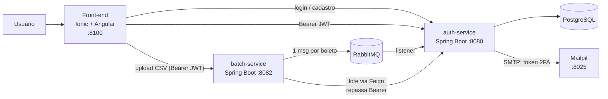
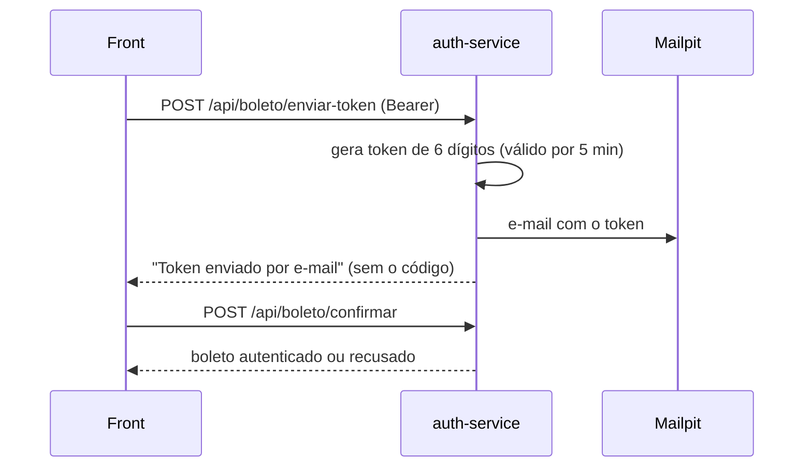

# 🔐 Authentication-Boleto

**Autenticação em duas etapas (2FA) para boletos bancários: antes de pagar, o boleto é validado na origem e confirmado com um código enviado por e-mail, contra a fraude de boleto adulterado no Brasil.**


<!-- GIF DA DEMO: grave login → upload do CSV → validar boleto → e-mail no Mailpit → confirmar token
     e salve em docs/demo.gif -->
<p align="center">
  
</p>

## 💡 O problema

O golpe do boleto falso troca a linha digitável ou o beneficiário antes de o pagador pagar. Aqui a empresa emissora registra os boletos, e o pagador só confirma depois de validar o boleto contra o cadastro original e digitar um código de 6 dígitos que chega por e-mail e expira em 5 minutos.

## ✨ Funcionalidades

| Módulo | O que faz |
| --- | --- |
| 🏢 Cadastro de empresa | Cadastro do emissor com preenchimento automático por CNPJ (ReceitaWS) e CEP (ViaCEP) |
| 💰 Cadastro de boletos | Criação manual ou importação em lote por CSV |
| 📦 Importação em lote | O serviço de lote lê o CSV e publica cada boleto numa fila do RabbitMQ |
| 🔐 Validação | Confere o boleto pelo código de barras e gera o token de verificação |
| 📧 Token por e-mail | Código de 6 dígitos, válido por 5 minutos, que nunca volta na resposta da API |
| ✅ Confirmação | O boleto só fica autenticado com o token correto e ainda válido |
| 📑 Logs | Histórico das validações com status válido ou inválido |
| 🛡️ Segurança | Login com JWT e respostas de erro padronizadas com `code`, sem expor detalhes internos |

## 🚀 Como rodar (Docker)

**Pré-requisito:** [Docker Desktop](https://www.docker.com/products/docker-desktop/) com Docker Compose v2.

```bash
git clone https://github.com/KURAMA2012/Authentication-Boleto.git
cd Authentication-Boleto
cp .env.example .env   # preencha DB_PASSWORD, RABBITMQ_PASSWORD e JWT_SECRET (32+ caracteres)
docker compose up --build
```

| Serviço | URL |
| --- | --- |
| Front-end (Ionic/Angular) | http://localhost:8100 |
| API de autenticação (Swagger) | http://localhost:8080/swagger-ui/index.html |
| Serviço de lote (Swagger) | http://localhost:8082/swagger-ui/index.html |
| Mailpit, a caixa de e-mail falsa | http://localhost:8025 |
| Painel do RabbitMQ | http://localhost:15672 (usuário e senha do `.env`) |

Para parar, use `docker compose down`. Para apagar também os dados do banco, use `docker compose down -v`.

## 🏗️ Arquitetura



Fluxo do token de verificação:



## 🧠 Decisões técnicas

- **Dois serviços (auth e batch):** a importação em massa de CSV tem outro ritmo de carga e de falha. Isolada, um arquivo grande não derruba o login nem a validação, e cada serviço escala separado.
- **Fila com RabbitMQ:** o upload responde na hora, e cada boleto é processado de forma assíncrona. Se o auth cair, as mensagens esperam na fila e nada se perde. Um boleto com erro não trava o resto do lote.
- **JWT stateless:** as rotas fora de `/api/auth/**` exigem `Authorization: Bearer`. O servidor não guarda sessão, o que permite escalar na horizontal, e o batch repassa o mesmo token quando chama o auth. O segredo vem do `JWT_SECRET` no `.env`, com no mínimo 32 bytes, e nunca entra no git.
- **2FA por e-mail:** o código do boleto sozinho não basta. A confirmação exige um token de uso único que expira em 5 minutos, e a API nunca devolve esse token na resposta. Na demo, o Mailpit captura o e-mail e nenhum dado real sai do ambiente.
- **Contrato de erro único:** todo erro volta como `ApiResponse` com um `code` estável, além de `message`, `details` e `traceId`. O front decide pelo `code`, não pelo texto. Um erro 500 não expõe nada interno, só um `traceId` para achar no log.
- **Dados fictícios:** a demo usa boletos e CPF/CNPJ inventados, mas em formato válido, por causa da LGPD e porque o repositório é público.


## 📬 Demonstração passo a passo (dados fictícios)

> Ambiente de demonstração: use só dados fictícios. Nenhum e-mail sai de verdade, porque o Mailpit captura tudo.

1. Crie uma conta em `POST /api/auth/cadastrar` (nome, email, senha, telefone, cpf) e faça login em `POST /api/auth/login?email=...&senha=...` para pegar o `data.token`.
2. Envie um CSV para `POST http://localhost:8082/api/boleto/upload` com `Authorization: Bearer <token>`:

   ```csv
   codigoBarras,valor,dataVencimento,cnpjEmpresa,nomePagador,cpfCnpjPagador
   23793381286008301234567890123456789012345678,150.00,2026-12-31,11222333000181,Cliente Ficticio,52998224725
   ```

3. Peça o token em `POST /api/boleto/enviar-token` com `{"codigoAutenticacao": "..."}`.
4. Abra http://localhost:8025 e veja o e-mail com o código de 6 dígitos.
5. Confirme em `POST /api/boleto/confirmar`.

## 🧪 Testes

```bash
cd backend-authentication-boleto && ./mvnw test   # 30 testes: JWT, erros, segurança, token e e-mail
cd backend-boleto-batch-service && ./mvnw test    # 10 testes: lote e upload de CSV
```

Os testes rodam sem Docker. O auth usa H2 e `JavaMailSender` mockado.

## 🧰 Stack

- **Back-end:** Java 17, Spring Boot 3.3, Spring Web, Data JPA, Security com JWT (jjwt), AMQP, Mail, OpenFeign, springdoc (Swagger), Lombok e Maven
- **Front-end:** Ionic 8, Angular 17 e Capacitor 8 (com build Android)
- **Infra:** PostgreSQL 16, RabbitMQ 3, Mailpit, Docker Compose e nginx
- **APIs externas:** ReceitaWS (CNPJ) e ViaCEP (CEP)

## 📁 Estrutura

```
Authentication-Boleto/
├── backend-authentication-boleto/   # API principal (8080): auth, boletos, token, empresas, logs
├── backend-boleto-batch-service/    # Serviço de lote (8082): CSV → RabbitMQ
├── frontend-app/                    # App Ionic/Angular (8100)
├── docker-compose.yml
└── .env.example
```

## ⚙️ Variáveis de ambiente

| Variável | Uso |
| --- | --- |
| `POSTGRES_DB`, `DB_USERNAME`, `DB_PASSWORD` | Banco do serviço de autenticação |
| `DB_URL` | JDBC para rodar fora do Docker (no compose ele é montado automaticamente) |
| `RABBITMQ_HOST`, `RABBITMQ_PORT`, `RABBITMQ_USERNAME`, `RABBITMQ_PASSWORD` | Fila usada pelos dois backends |
| `JWT_SECRET`, `JWT_EXPIRATION_MS` | Assinatura e validade do JWT |
| `BOLETO_SERVICE_URL` | API de boleto chamada pelo serviço de lote |
| `MAIL_HOST`, `MAIL_PORT`, `MAIL_FROM`, `MAIL_DEFAULT_TO` | SMTP do envio do token (no compose ele aponta para o Mailpit) |

### Problemas comuns

- **Porta ocupada (5432, 5672, 8025, 8080, 8082 ou 8100):** pare o serviço local ou o container antigo que usa a porta.
- **O compose reclama de `DB_PASSWORD` ou `RABBITMQ_PASSWORD`:** essas variáveis estão vazias no `.env`.
- **O banco não sobe depois de trocar a senha:** o volume guarda a senha antiga. Rode `docker compose down -v` e suba de novo.

Mais sobre secrets: [docs/security.md](docs/security.md).

## 🎥 Apresentação

- [Parte 1](https://youtu.be/3DozZnX-OZg)
- [Parte 2](https://youtu.be/zjEa-hGpCfQ)
- [Parte 3](https://youtu.be/3XuRNAA6-4s)

---

Projeto acadêmico (A3), evoluído para portfólio por **Davy Lucas**.