# 🔐 Authentication-Boleto

**Autenticação em duas etapas (2FA) para boletos bancários: antes de pagar, o boleto é validado na origem e confirmado com um código enviado por e-mail, contra a fraude de boleto adulterado no Brasil.**


<!-- GIF DA DEMO: grave login → upload do CSV → validar boleto → e-mail no Mailpit → confirmar token
     e salve em docs/demo.gif -->
<p align="center">
  
</p>

## 💡 O problema

O golpe do boleto falso troca a linha digitável ou o beneficiário antes de o pagador pagar. Aqui a empresa emissora registra os boletos, e o pagador só confirma depois de validar o boleto contra o cadastro original e digitar um código de 6 dígitos que chega por e-mail e expira em 5 minutos.

## ✨ Funcionalidades

| Módulo | O que faz |
| --- | --- |
| 🏢 Cadastro de empresa | Cadastro do emissor com preenchimento automático por CNPJ (ReceitaWS) e CEP (ViaCEP) |
| 💰 Cadastro de boletos | Criação manual ou importação em lote por CSV |
| 📦 Importação em lote | O serviço de lote lê o CSV e publica cada boleto numa fila do RabbitMQ |
| 🔐 Validação | Confere o boleto pelo código ou código de barras (e CNPJ, se informado) e dá o veredito AUTENTICO/SUSPEITO |
| 📧 Token por e-mail | Código de 6 dígitos, válido por 5 minutos, que nunca volta na resposta da API |
| ✅ Confirmação | O boleto só fica autenticado com o token correto e ainda válido |
| 📑 Logs | Histórico das validações com status válido ou inválido |
| 📊 Painel | Métricas por empresa: boletos emitidos, validações autênticas e suspeitas por dia |
| 🌐 Validação pública | Pagador valida sem login, com rate limit por IP |
| 🛡️ Segurança | Login com JWT e respostas de erro padronizadas com `code`, sem expor detalhes internos |

## 🎯 Visão de produto

Duas personas, dois fluxos:

| Persona | Quem é | O que usa |
| --- | --- | --- |
| 🏢 **Empresa emissora (B2B)** | Quem emite boletos (PME, escola, condomínio, fintech) | Cadastra-se, registra empresas pelo CNPJ, emite ou importa boletos e acompanha um **painel com métricas** de validações autênticas e suspeitas |
| 🙋 **Pagador** | Quem recebeu um boleto e vai pagar | **Validação pública e gratuita**, sem login: informa o código ou o código de barras, recebe o veredito **AUTENTICO/SUSPEITO** e confirma com um token de 6 dígitos por e-mail (2FA) |

### 💼 Modelo de negócio (planejado)

- **Pagador:** validação sempre gratuita. Quanto mais gente valida, mais valor o selo tem para quem emite.
- **Empresa emissora:** painel B2B no formato SaaS, com assinatura por empresa ou plano por volume de boletos. Inclui métricas, histórico de tentativas suspeitas e importação em lote.
- Modelo ainda em estudo: não há preços definidos nem cobrança implementada.

### Fluxo da empresa

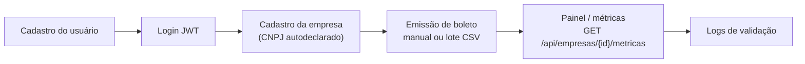

### Fluxo do pagador

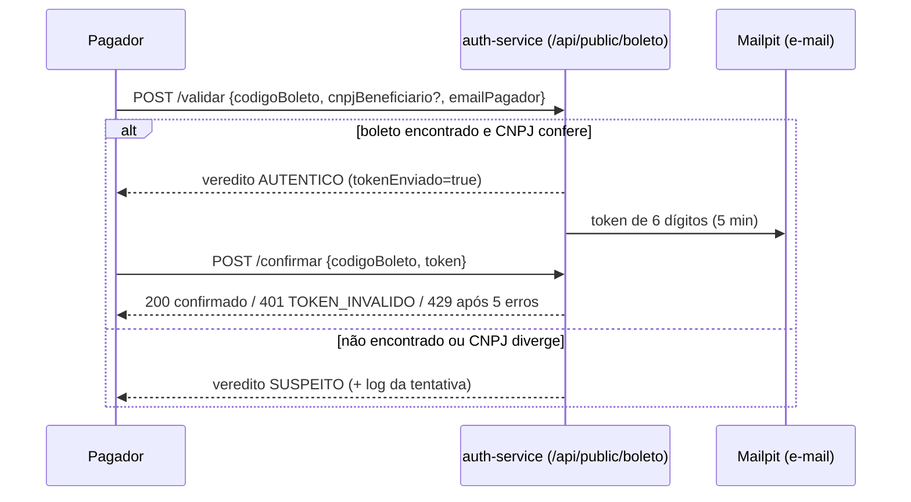

## 🛣️ Rotas públicas x protegidas

| Tipo | Rotas | Acesso |
| --- | --- | --- |
| Pública | `POST /api/public/boleto/validar`, `/enviar-token`, `/confirmar` (alias legado `/api/boleto/*`) | Sem JWT, com **rate limit de 10 req/60 s por IP + rota** (429 `LIMITE_TENTATIVAS`) |
| Pública | `POST /api/auth/cadastrar`, `POST /api/auth/login` | Sem JWT |
| Protegida | `/api/empresas/**` (`/cadastrar`, `/minhas`, `/{id}/metricas`...), logs e emissão de boletos | `Authorization: Bearer <JWT>` |

- O JWT leva o e-mail do usuário (principal) e a **role** (`EMPRESA` ou `ADMIN`).
- Cada empresa tem um **dono**. Quem não é dono recebe **403 `ACESSO_NEGADO`**; empresa inexistente dá **404**. `ADMIN` enxerga tudo.
- O token 2FA aceita **no máximo 5 tentativas erradas**. Depois disso é cancelado (429 `LIMITE_TENTATIVAS`) e é preciso pedir outro.
## 🚀 Como rodar (Docker)

**Pré-requisito:** [Docker Desktop](https://www.docker.com/products/docker-desktop/) com Docker Compose v2.

```bash
git clone https://github.com/KURAMA2012/Authentication-Boleto.git
cd Authentication-Boleto
cp .env.example .env   # já vem com valores de demo; é só copiar e rodar
docker compose up --build
```

| Serviço | URL |
| --- | --- |
| Front-end (Ionic/Angular) | http://localhost:8100 |
| API de autenticação (Swagger) | http://localhost:8080/swagger-ui/index.html |
| Serviço de lote (Swagger) | http://localhost:8082/swagger-ui/index.html |
| Mailpit, a caixa de e-mail falsa | http://localhost:8025 |
| Painel do RabbitMQ | http://localhost:15672 (usuário e senha do `.env`) |

Para parar, use `docker compose down`. Para apagar também os dados do banco, use `docker compose down -v`.

## 🏗️ Arquitetura

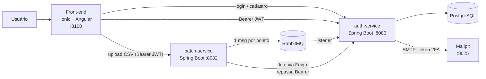

Fluxo do token de verificação:

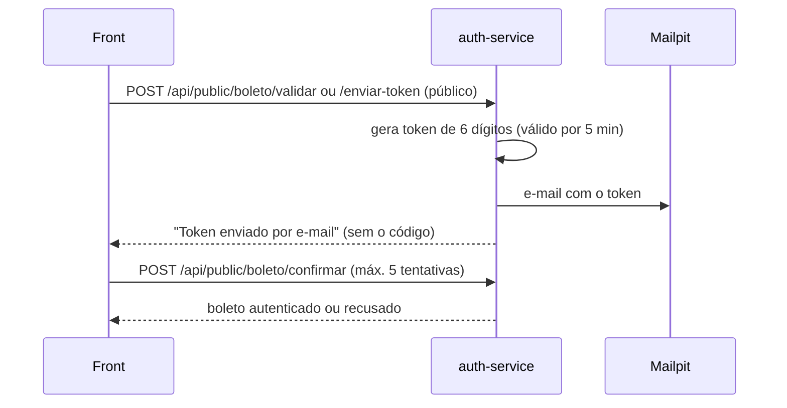

## 🧠 Decisões técnicas

- **Dois serviços (auth e batch):** a importação em massa de CSV tem outro ritmo de carga e de falha. Isolada, um arquivo grande não derruba o login nem a validação, e cada serviço escala separado.
- **Fila com RabbitMQ:** o upload responde na hora, e cada boleto é processado de forma assíncrona. Se o auth cair, as mensagens esperam na fila e nada se perde. Um boleto com erro não trava o resto do lote.
- **JWT stateless:** as rotas fora de `/api/auth/**` e `/api/public/**` exigem `Authorization: Bearer`. O servidor não guarda sessão, o que permite escalar na horizontal, e o batch repassa o mesmo token quando chama o auth. O segredo vem do `JWT_SECRET` no `.env`, com no mínimo 32 bytes, e nunca entra no git.
- **2FA por e-mail:** o código do boleto sozinho não basta. A confirmação exige um token de uso único que expira em 5 minutos, e a API nunca devolve esse token na resposta. Na demo, o Mailpit captura o e-mail e nenhum dado real sai do ambiente.
- **Contrato de erro único:** todo erro volta como `ApiResponse` com um `code` estável, além de `message`, `details` e `traceId`. O front decide pelo `code`, não pelo texto. Um erro 500 não expõe nada interno, só um `traceId` para achar no log.
- **Dados fictícios:** a demo usa boletos e CPF/CNPJ inventados, mas em formato válido, por causa da LGPD e porque o repositório é público.

### ⚠️ Limitações conhecidas

- **CNPJ autodeclarado:** o sistema valida os dígitos do CNPJ e impede duplicidade, mas não comprova que quem cadastrou é de fato o dono da empresa.
- **Rate limit em memória:** a contagem fica por instância. Com várias réplicas, o ideal seria um armazenamento compartilhado (ex.: Redis) ou o limite no gateway.
- **Métrica de fraude indicativa:** "suspeitas" contam tentativas com código inexistente ou CNPJ divergente. Isso mostra sinais, não fraude confirmada.
- **Schema via `ddl-auto=update`:** prático para a demo, mas em produção o certo seria migração versionada (Flyway/Liquibase).
## 🧪 Como testar a demo

Ao subir, o `DemoDataSeeder` cria uma única vez (dados 100% fictícios) o usuário demo, uma empresa demo, 5 boletos e cerca de 30 dias de histórico de validações para o painel.

| Item | Valor |
| --- | --- |
| Login do painel | `demo@authboleto.local` / `Demo@12345` |
| Boleto autêntico | `DEMO-AUTENTICO-0001` |
| Código de barras | `23790000100000000000000000000000000000000001` |
| CNPJ do beneficiário | `11.222.333/0001-81` |
| E-mail do pagador | `pagador@demo.local` |
| Caixa de e-mail (token) | http://localhost:8025 |

1. **AUTENTICO:** em http://localhost:8100 (ou `POST /api/public/boleto/validar`), valide com o código de barras, o CNPJ e o e-mail acima.
   ```json
   {"codigoBoleto":"23790000100000000000000000000000000000000001","cnpjBeneficiario":"11.222.333/0001-81","emailPagador":"pagador@demo.local"}
   ```
2. Abra o Mailpit em http://localhost:8025 e copie o token de 6 dígitos.
3. Confirme em `POST /api/public/boleto/confirmar` com `{"codigoBoleto":"DEMO-AUTENTICO-0001","token":"<token>"}`.
4. **SUSPEITO:** valide qualquer código inventado, por exemplo `{"codigoBoleto":"QUALQUER-COISA-123"}`. O veredito vem `SUSPEITO` e a tentativa aparece nos logs e nas métricas.
5. Entre no painel com o login demo para ver as métricas e os logs.
6. Lote CSV (opcional): envie para `POST http://localhost:8082/api/boleto/upload` com `Authorization: Bearer <token>`:

   ```csv
   codigoBarras,valor,dataVencimento,cnpjEmpresa,nomePagador,cpfCnpjPagador
   23793381286008301234567890123456789012345678,150.00,2026-12-31,11222333000181,Cliente Ficticio,52998224725
   ```

## 🖼️ Galeria

Capturas com dados fictícios em [`docs/prints/`](docs/prints/).

| Tela | Legenda |
| --- | --- |
| 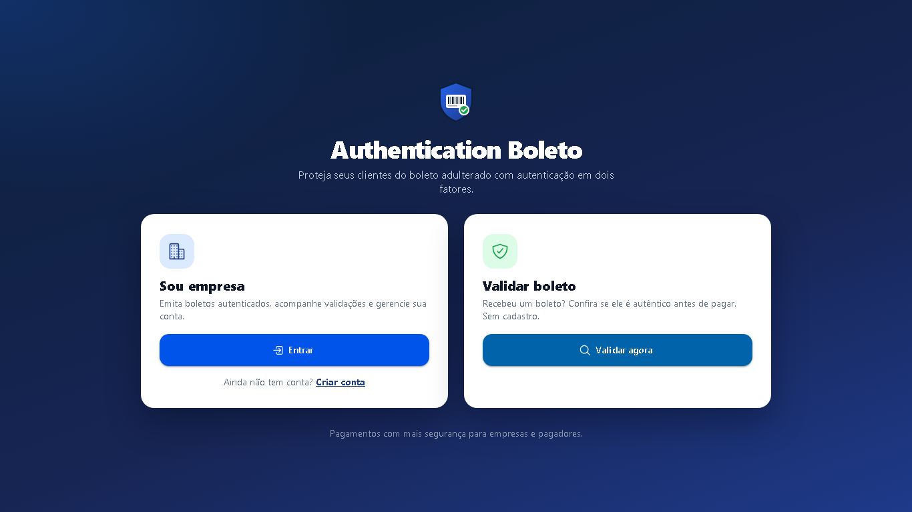 | **01** Início público: o pagador valida sem login |
| 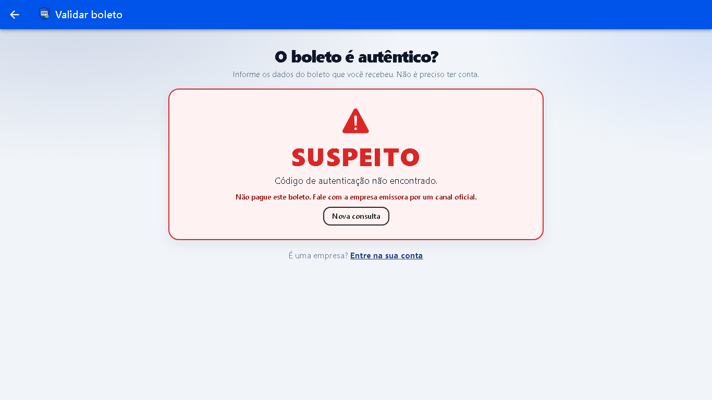 | **02** Veredito SUSPEITO para código inexistente |
| 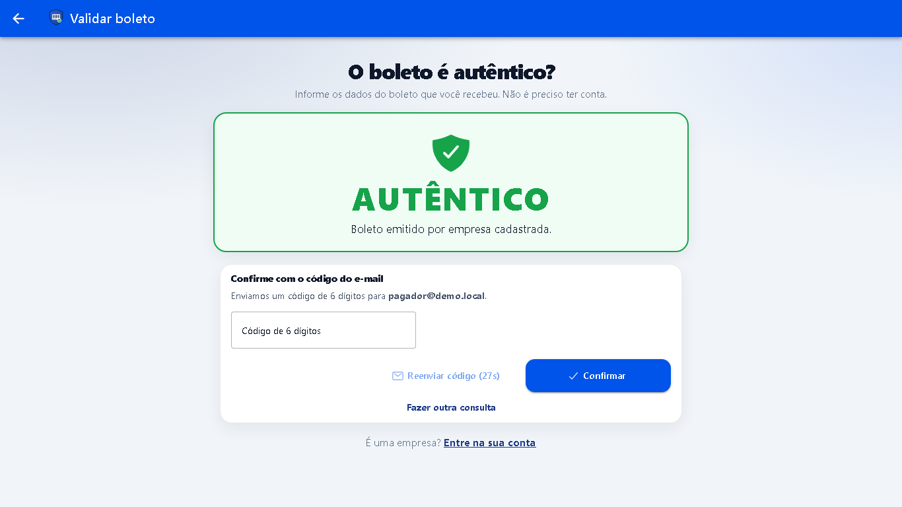 | **03** Veredito AUTENTICO e token enviado por e-mail |
| 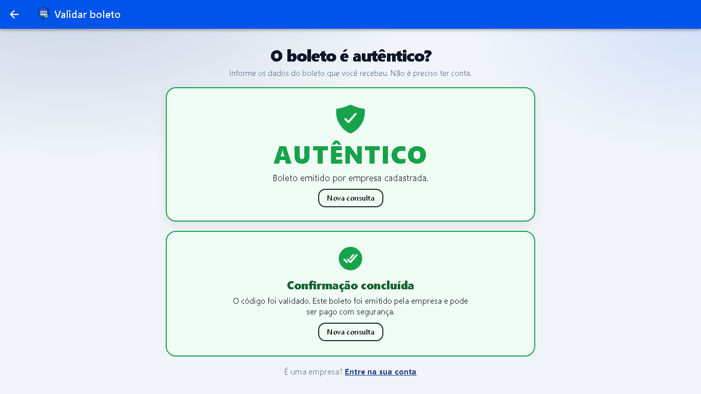 | **04** Boleto confirmado com o token |
| 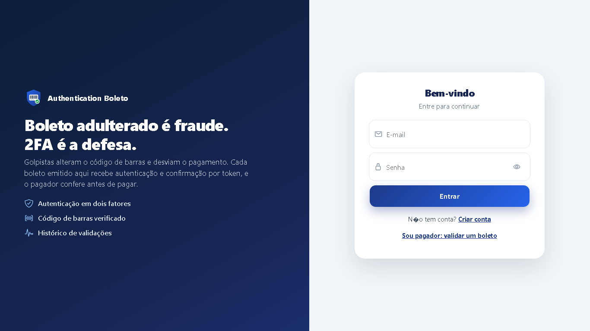 | **05** Login da empresa |
| 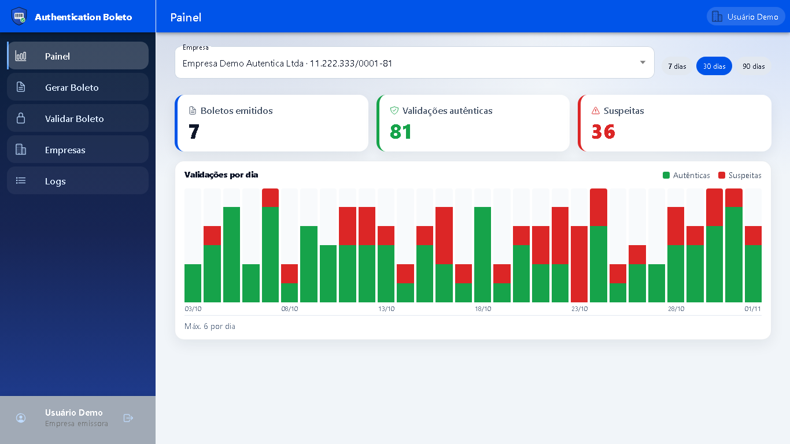 | **06** Painel da empresa com métricas de 30 dias |
| 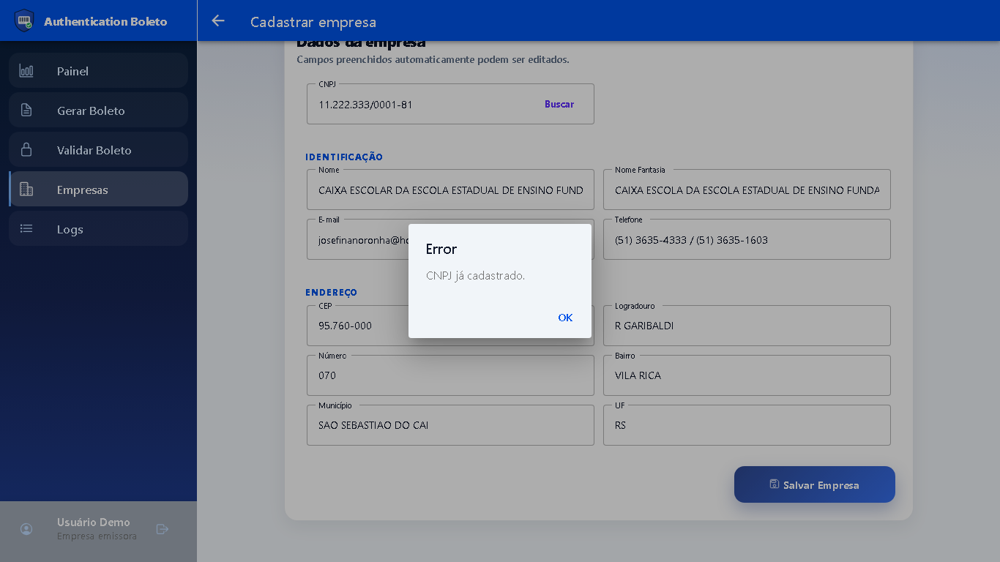 | **07** Minhas empresas |
| 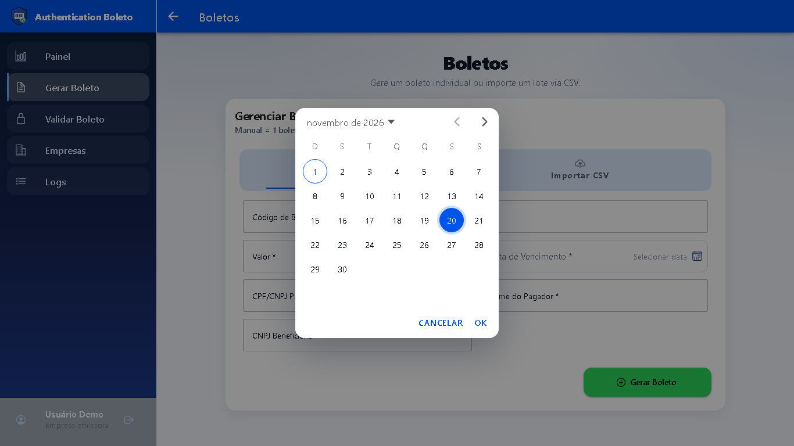 | **08** Emissão de boleto |
| 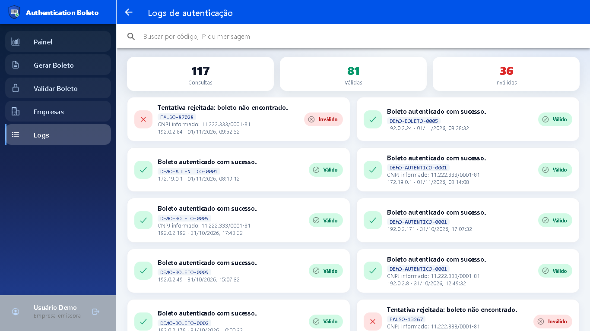 | **09** Logs de validação |
| 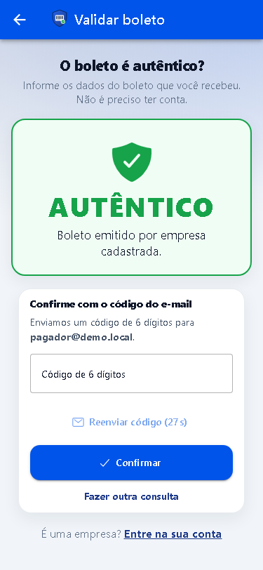 | **10** Validação no celular |
| 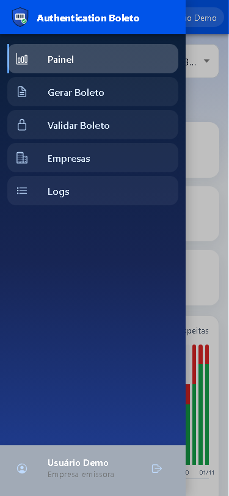 | **11** Painel no celular |
## ✅ Testes

```bash
cd backend-authentication-boleto && ./mvnw test   # 65 testes: JWT, erros, segurança, rate limit, token, métricas, seed
cd backend-boleto-batch-service && ./mvnw test    # 10 testes: lote e upload de CSV
```

Os testes rodam sem Docker. O auth usa H2 e `JavaMailSender` mockado.

## 🧰 Stack

- **Back-end:** Java 17, Spring Boot 3.3, Spring Web, Data JPA, Security com JWT (jjwt), AMQP, Mail, OpenFeign, springdoc (Swagger), Lombok e Maven
- **Front-end:** Ionic 8, Angular 17 e Capacitor 8 (com build Android)
- **Infra:** PostgreSQL 16, RabbitMQ 3, Mailpit, Docker Compose e nginx
- **APIs externas:** ReceitaWS (CNPJ) e ViaCEP (CEP)

## 📁 Estrutura

```
Authentication-Boleto/
├── backend-authentication-boleto/   # API principal (8080): auth, boletos, token, empresas, logs
├── backend-boleto-batch-service/    # Serviço de lote (8082): CSV → RabbitMQ
├── frontend-app/                    # App Ionic/Angular (8100)
├── docker-compose.yml
└── .env.example
```

## ⚙️ Variáveis de ambiente

| Variável | Uso |
| --- | --- |
| `POSTGRES_DB`, `DB_USERNAME`, `DB_PASSWORD` | Banco do serviço de autenticação |
| `DB_URL` | JDBC para rodar fora do Docker (no compose ele é montado automaticamente) |
| `RABBITMQ_HOST`, `RABBITMQ_PORT`, `RABBITMQ_USERNAME`, `RABBITMQ_PASSWORD` | Fila usada pelos dois backends |
| `JWT_SECRET`, `JWT_EXPIRATION_MS` | Assinatura e validade do JWT |
| `BOLETO_SERVICE_URL` | API de boleto chamada pelo serviço de lote |
| `MAIL_HOST`, `MAIL_PORT`, `MAIL_FROM`, `MAIL_DEFAULT_TO` | SMTP do envio do token (no compose ele aponta para o Mailpit) |

### Problemas comuns

- **Porta ocupada (5432, 5672, 8025, 8080, 8082 ou 8100):** pare o serviço local ou o container antigo que usa a porta.
- **O compose reclama de `DB_PASSWORD`, `RABBITMQ_PASSWORD` ou `JWT_SECRET`:** o `.env` não existe ou foi editado com valor vazio. Rode de novo `cp .env.example .env`. Os valores do exemplo são apenas para demo local; troque em produção.
- **O banco não sobe depois de trocar a senha:** o volume guarda a senha antiga. Rode `docker compose down -v` e suba de novo.

Mais sobre secrets: [docs/security.md](docs/security.md).

## 🎥 Apresentação

---

Projeto acadêmico (A3), evoluído para portfólio por **Davy Lucas**.
